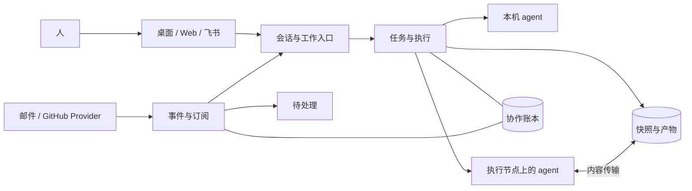

# 架构

Steve 是一个模块化 Go 服务，使用 ACP 运行用户管理的 agent，用同一份账本记录任务与协作事实。桌面、Web 和消息通道共享执行能力；外部 Provider 通过受限 HTTP 接口提交事件或工作。

## 对象和数据归属

| 对象 | 责任 |
| --- | --- |
| 项目 | 主目录、可选工作区、数据等级与访问授权 |
| Agent | 执行机器、harness、模型偏好、技能与 MCP 引用 |
| 会话 | 项目绑定、agent 选择、输入队列、回复和问答 |
| 任务 | 目标、预算、父子关系与执行历史 |
| Attempt | 一次执行的身份、租约、机器、用量和结果 |
| 产物 | 工作目录快照、内容副本及合并落地记录 |
| 事件 | 不可变输入、冻结的订阅版本、处理回执与因果关系 |

配置文件是项目、工作区和配置 ACL 的声明权威，账本保存运行事实。配置保存检查原文件指纹；投影未应用完成时拒绝项目执行，并从当前声明恢复。删除声明保留历史，但历史本身不能授权新执行。

单机账本使用 SQLite。完整节点通过 Raft 复制账本，权威写入依赖多数派。账本中的内容摘要与实际文件副本分别管理；存在记录不证明文件仍可读取。

## 模块关系

| 模块 | 职责 |
| --- | --- |
| `cmd/steve`、`app`、`configbuild` | 进程入口、依赖装配与配置应用 |
| `httpapi`、`consoleapi`、`serviceapi` | HTTP 鉴权、解析与服务契约 |
| `conversation`、`console`、`gateway` | 会话状态、持久输入与通道适配 |
| `turn`、`delegate`、`exec` | 对话、委派和计划编排 |
| `execution`、`lifecycle`、`task`、`attempt` | 执行身份、预算、租约、停止与完成 |
| `identity`、`control`、`interaction` | 账号、资源权限与原执行问答 |
| `events`、`work`、`clientcap`、`servicehub` | 事件订阅、受控工作、客户端能力及恢复 |
| `artifact`、`artifact/gitrepo`、`material` | 快照、内容副本、合并、引用与批注 |
| `node`、`nodewire`、`acphost` | 节点连接、原生会话与 ACP |
| `plugins`、`plugins/pluginledger` | 固定能力包、安装声明和运行引用 |
| `ledger`、`readmodel` | 事务事实与只读查询投影 |

领域层不反向引用 HTTP 或 UI，调用者通过所需接口依赖服务。`config` 与 `i18n` 不链接执行及存储层，`consoleapi` 不链接执行层。节点的 SQLite 保存本机会话，不引入协调账本。

[服务边界](service-boundaries.md)给出输入、身份、事件和客户端能力的具体契约。[配置参考](configuration.md)列出运行参数。

## 执行与完成

任务准入检查项目权限、数据等级、机器能力、预算和工作目录租约。任务树的轮数在同一持久更新中扣减，完成时只传播本次执行用量，避免父子费用重复累计。耗时是执行后观测值，不能预先保证为严格的墙钟费用上限。

执行完成把租约校验、结果版本检查、结果与用量、Bound 状态放在同一账本事务中。快照发布是独立事实；结果提交失败时不报告成功或继续落地。

普通交互使用主目录或就绪副本，目录选择不读取 `repo` 隔离声明。委派和计划步骤在隔离树工作。影子 Git 仓库提供快照、Diff 和 bundle，不改源仓库分支。隔离产物经合并写回主目录；等待、应用中、冲突和已完成分别持久化。正在应用的落地按原目录和日志恢复，配置变更不能将其换到另一个目录。

## 委派与交接

委派子任务有独立 attempt，受共同祖先预算、深度和环检测约束。父回合正常结束后子任务继续执行；用户停止、暂停或取消会撤销相应执行资格并请求子树停止。

子任务结果持久化和父会话收到结果分别记录。交接固定成员批次与稳定键，重试只核对原批次。Console 使用持久 Exchange 接收，父处理完成后才确认投递；飞书外部发送不明时保留不确定状态。

暂停父任务保留结果，恢复后处理。已关闭的父任务保留未投递说明，不为送达结果而创建新任务。`steve_await` 可读取已保存的子任务结果；正常交接不要求父 agent 轮询。

## 停止与恢复

执行节点保存原生会话、输入回执和有界输出日志。续接核对原身份与确认位置，不重发已受理输入。协调职责变更不等同于进程停止。

网络断开、租约过期、协调代变化均不能证明原写入者退出。无法核实的执行保持隔离，其目录及受限容量不交给替代执行。启动先分类旧执行，再恢复允许继续的工作。用户授权新恢复执行时，旧 epoch 不再有提交资格。

计划步骤输出随原执行结果提交，调度检查点不能替代完成事实。结果已提交而缓存丢失时从结果重建，不再次调用模型。取消阻止新的执行与落地准入，不能撤回已经发生的文件或外部写入。

## 身份与能力

原生账号身份为通道与账号 ID 的组合，连接凭据是独立的受限委托。相同字符串、会话前缀或已保存上下文都不构成授权。平台工具核对原执行身份和当前项目权限。

Agent 在隔离运行 home 中使用所需认证和模型配置，技能与 MCP 由 Steve 装配。插件会话固定包摘要和运行配置，旧会话不自动换成新版。隔离 home 和工作区回调不构成操作系统安全沙箱。

项目数据等级限制放置位置。完整节点保存私有账本，至少具备 `restricted` 授权；共享账本不支持只允许内容留在单机的 `sealed` 项目。

## 多 Hub 归属与迁移

独立实例有稳定 Hub 身份，每个 node 实例只归属一个协调身份。正常断线或超时不将节点交给其他 Hub。集群节点使用集群身份绑定，独立实例的迁移通过停服后的显式导出、导入与节点 adopt 完成。

[项目迁移](project-migration.md)包含内容、运行记录和身份重映射。跨实例不复制连接凭据，也不把旧运行中的进程当作目标上的活会话。

## 读取与呈现

只读模型将账本投影为任务、机器、历史和用量。SSE 用于刷新 UI，业务消费者使用持久事件和回执。未知值保留为未知，查询失败不显示健康零值。

用量以已结束 attempt 的报告为源。未上报与上报零分开记录；输入加输出是 token 总量，缓存单列。根任务耗时按父子时间区间并集合计，TPM 是区间估算而非实时生成速度。

React/Vite 控制台通过 API 读取数据，共享 React Aria 与 Untitled UI 组件。页面负责请求与状态，展示组件负责阅读和交互；本地草稿、外观及阅读位置由客户端保存。
